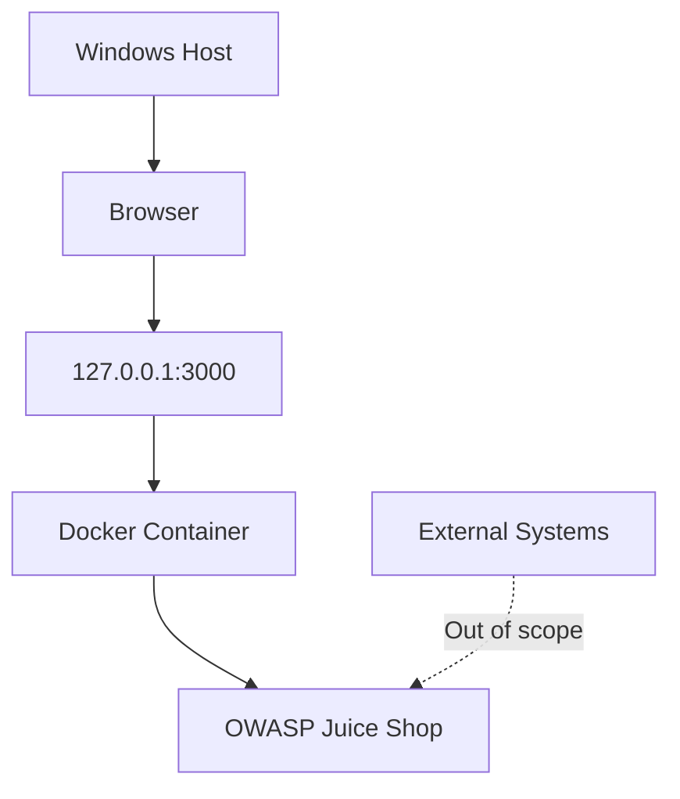

# Ethical Hacking — Task 1
## Legal Scope and Isolated Lab

### Objective
Create a controlled local web security lab and document the authorized testing scope.

### Lab Environment
- Target: OWASP Juice Shop
- Runtime: Docker
- Target URL: http://127.0.0.1:3000
- Published port: TCP 3000, loopback binding
- Purpose: Beginner-level web security education

### Network Topology


### Scope and Safety
Only the locally controlled Juice Shop instance is in scope. Third-party systems, production websites, public IP targets, destructive tests, denial-of-service, and unauthorized data access are excluded.

Testing must stop immediately if the target or scope becomes uncertain, unexpected external traffic occurs, or the host becomes unstable.

### Evidence
- `evidence/lab-running.png` — application running locally
- `evidence/localhost-binding.png` — Docker port binding verification
- `RULES-OF-ENGAGEMENT.md` — scope, permissions, exclusions, and stop conditions

### Cleanup
Stop the container after testing:
```powershell
docker stop juice-shop-lab
```

### Learning Outcomes
This exercise demonstrates local lab setup, scope definition, network exposure reduction, evidence collection, and responsible security testing.

**Verification status:** Record only checks actually completed. A localhost port binding alone does not establish complete network isolation.
